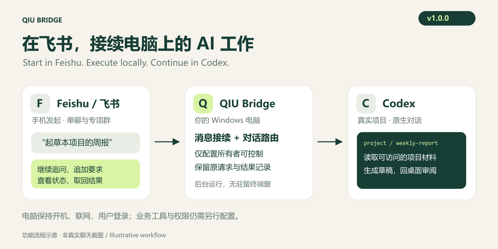
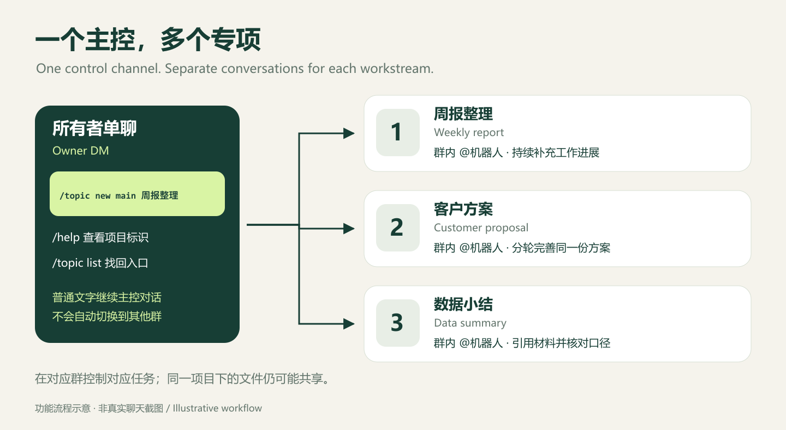
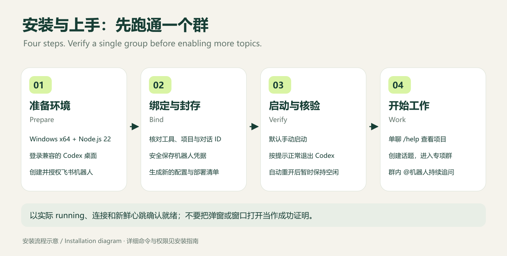

# QIU Bridge v1.0

**Start work in Feishu. Execute on your Windows computer. Continue reviewing in the same real Codex project conversation.**



[中文介绍](README.zh.md) · [Download v1.0.0](https://github.com/yfanqiu-dot/lark-chatgpt-bridge/releases/tag/v1.0.0) · [Installation](README.desktop.md) · [Full user guide](docs/user-guide.en.md) · [Office examples](docs/office-workflows.en.md)

For an individual who already uses Codex on Windows: plan work from an owner-only Feishu DM, follow each workstream in its own group, append instructions, handle supported approvals and retrieve results. Your computer does the work and must remain on, online and signed in.

## What it helps with

| Situation | Workflow |
|---|---|
| You are away, but the materials are on your computer | Reference accessible project files and ask the local Codex conversation to process them |
| Reports, proposals and data work get mixed together | Create one topic group and native conversation per workstream |
| You keep explaining the background again | Continue the same conversation in Feishu and on the desktop |
| Progress or delivery is unclear | Check `/status`, retrieve a saved `/result`, or reconcile the original request |
| Dissolved test groups clutter discovery | A maintainer registers evidence-backed retirement to hide their links while preserving history |

The bridge connects messages and conversations. Feishu documents, calendars, tasks, Base, GitHub and other business operations require separately configured Codex tools and authorization.

## One control channel, several workstreams



- **Optional owner DM:** send text without a mention; create or find topics.
- **Entry group:** mention the bot to work or manage topics.
- **Topic group:** follow the same matter and control its own task.
- **Codex desktop:** return to your project, inspect materials and finish delivery.

The DM is not a global controller. Control each task from its own group. Conversations in one project may access the same files; separate conversations do not imply file isolation.

## Install and verify one group first



Requirements: **Windows x64, Node.js 22 LTS, a compatible signed-in Codex desktop and your own Feishu bot.** Initial setup requires command-line experience.

1. Download the [Windows ZIP and SHA256SUMS.txt](https://github.com/yfanqiu-dot/lark-chatgpt-bridge/releases/tag/v1.0.0), verify the hash and extract to a permanent directory.
2. Follow [installation](README.desktop.md) to store credentials and verify the tool catalog, project and existing native conversation.
3. Prepare a sealed deployment and manual service entry; verify one group's message round trip.
4. Optionally enable [full mode and owner DM](docs/desktop-p4-deployment.md).

The ZIP contains built code, the GUI launcher and production dependencies. It excludes Node.js, Codex, a bot and personal configuration. The upstream npm package does not install this desktop distribution.

**Manual startup is the default.** Login startup requires separate configuration. If cold startup waits for Codex to exit, save your work and normally quit the entire app. After it reopens, leave it idle for verification. Check state, connection and a fresh heartbeat; a popup is not proof of readiness. Normally quitting the managed desktop closes its messaging channel.

## Try a weekly report

In the configured bot DM, send `/help` to find project keys. Replace the example `main` with your own key:

```text
/topic new main Weekly report
```

Open the returned group link, mention the bot and send:

```text
Draft a weekly report from this project's work records.
Include completed work, risks and next steps, with source files.
Mark missing information. Return a draft; do not send it elsewhere or change source records.
```

Follow up in that group; use `/topic list` in the DM to find it again. Check status before repeating a slow creation request. Identical titles do not deduplicate new messages.

| Command | Purpose |
|---|---|
| `/help` | Control-channel help and configured project keys |
| `/topic list` | Discover topics, excluding registered retirements |
| `/topic new <project> <title>` | Create a native conversation and private group |
| `/status` | Inspect this conversation's execution, queue and approvals |
| `/steer Instructions` | Append requirements to an eligible active task |
| `/stop` | Request interruption of this conversation's task; queued requests remain |
| `/result [originalMessageId]` | Retrieve a saved answer without running it again |
| `/reconcile` | Check the original uncertain request without resubmitting it |

Group commands also require a mention. See the [full guide](docs/user-guide.en.md) for approvals, `/topic resume`, files, queues and recovery.

## What's new in v1.0.0

- A GUI-subsystem package launcher starts the broker without allocating a console, preserving package identity and ownership checks.
- Native IPv4/IPv6 TCP ownership checks remove the slow lookup behind `shared_observation_stale`, retaining the five-second proof window.
- Evidence-backed topic retirement hides old discovery and index links while preserving bindings and ledgers. Old requests do not recreate retired groups.
- Illustrated introduction, installation and use guides ship with the offline-readable ZIP.

[Release notes](docs/releases/v1.0.0.md) · [Validation scope](docs/releases/v1.0.0-validation.md)

## Supported scope

Windows x64, one configured owner, registered groups and an explicitly configured DM, with text input and final text results. Attachments are not automatically model input; local files are not automatically uploaded. Multi-user hosting, full desktop mirroring and guaranteed unattended operation are outside this release.

Retirement hides discovery entries; it does not delete history or disable native bindings. Unified `/topic delete`, `/topic rename` and `/topic archive` commands do not exist. Do not delete bound conversations or erase ledgers to recover service. Each installation, project and Codex update needs verification. See [compatibility and limits](docs/compatibility.md).

Private configuration, credentials, ledgers and raw runtime evidence are excluded from source and release packages. Requests and results still pass through Feishu and configured Codex services.

## Build and attribution

```powershell
git clone https://github.com/yfanqiu-dot/lark-chatgpt-bridge.git
cd lark-chatgpt-bridge
git checkout v1.0.0
npx --yes pnpm@10.33.0 install --frozen-lockfile
npx --yes pnpm@10.33.0 build
```

Checks: `pnpm test`, `pnpm typecheck`, `pnpm build`. Windows source builds compile the GUI launcher with the system .NET Framework C# compiler; downloaded bundles include it already.

[Development](docs/development.md) · [Security](SECURITY.md) · [Issues](https://github.com/yfanqiu-dot/lark-chatgpt-bridge/issues) · [Independent CLI backend](docs/cli-backend.en.md)

Based on [zarazhangrui/lark-coding-agent-bridge](https://github.com/zarazhangrui/lark-coding-agent-bridge), under the [MIT license](LICENSE). An independent community integration, not an OpenAI or Feishu product.
