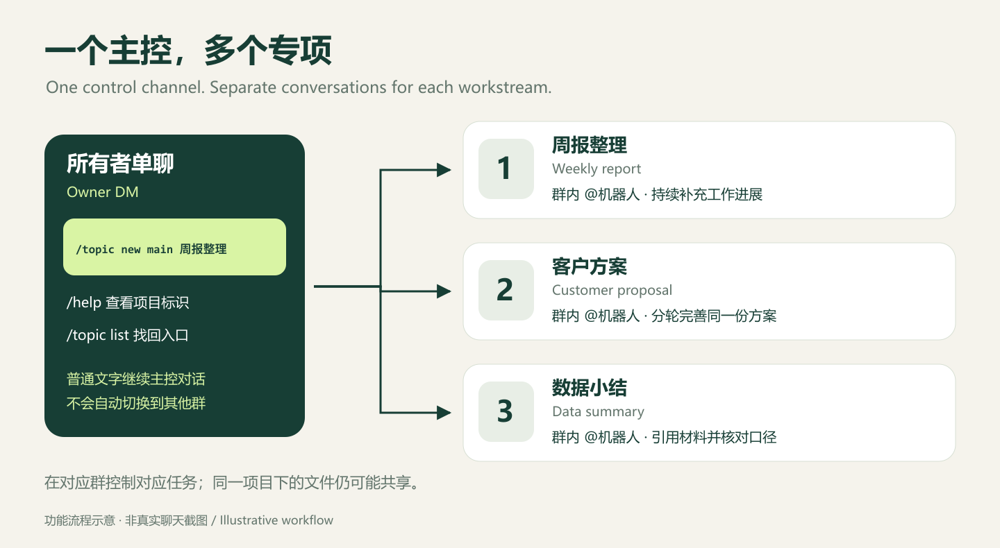

# 多话题使用入口

v1.0.0 包含多话题完整模式。首次安装仍从单群开始，再显式启用登记群和新话题创建。



在已启用的单聊主控直接发送，或在配置的入口群 @ 机器人发送：

```text
/topic new main 周报整理
```

用自己的项目标识替换 `main`。创建的是原生 Codex 项目对话及对应飞书私有群；普通追问继续当前群的对话，不另建资源。

- [完整功能部署与资源接续](docs/desktop-p4-deployment.md#完整功能部署-v090)
- [办公场景与提问模板](docs/office-workflows.zh.md)
- [首次安装](README.desktop.md)
- [完整使用方法与小技巧](docs/user-guide.zh.md)
- [开发设计与验收摘要](docs/development.md)

本页替代早期 P2 开发入口。当前使用与恢复步骤以安装、运维说明为准。

## 单聊主控

v0.10.0 可显式绑定一个与机器人的单聊作为主控，原入口群保留。单聊无需 @，只有配置的所有者及精确匹配的单聊 ID 可用；默认安装仍关闭单聊。

1. 在主控单聊用普通文字安排工作，或发送 `/help` 查看项目标识。
2. 发送 `/topic new main 客户方案`，创建独立 Codex 对话和飞书私有群。
3. 点击回复中的“进入话题群”，在群里 @机器人开展专项工作。
4. 回到单聊用 `/topic list` 查找各话题入口。单聊中的 `/status`、`/stop`、`/result` 等只控制单聊自己的对话。

普通文字不会自行创建群或切换目标。主控与各群互不共享消息账本，也不会把旧版 CLI 的会话历史自动复制到新的桌面对话。

配置方法见[单聊主控部署](docs/desktop-p4-deployment.md#单聊主控配置-v0100)。

## 已退役话题

管理员核实群已解散并登记退役后，`/topic list` 和本地对话索引不再显示该群入口。对旧创建请求使用 `/topic resume` 会提示话题已退役，不会自动创建替代群。新业务仍通过显式的 `/topic new` 建立。

退役记录与原注册表、绑定、账本及历史文件分开保存；隐藏入口不会删除历史。维护者操作和字段约束见[话题退役维护说明](docs/topic-retirement.md)。缺少退役文件表示尚无退役记录；格式或绑定校验失败时拒绝生成列表，不把错误当成无记录。运行包通过正常部署流程更新，不直接修改正在运行的封存包。

## 话题管理边界

创建只发送一次；相同标题的新消息可能另建话题。`/topic resume <原消息编号>` 仅接续未完成的创建，不恢复已删除资源。

当前没有统一的改名、归档、停用、解绑和删除命令。两侧改名不会自动同步列表标题；解散群不会自动取消任务或删除 Codex 对话；删除已绑定对话可能阻断整个 Bridge 的后续启动。操作前请阅读[完整管理说明](docs/user-guide.zh.md#7-话题改名归档和删除)，由维护者核对绑定和部署，避免自行删记录绕过检查。
