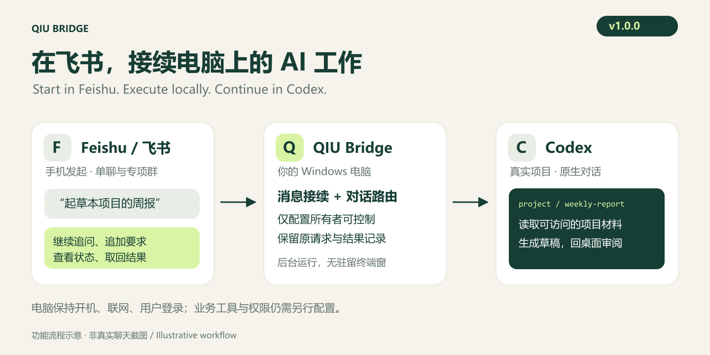
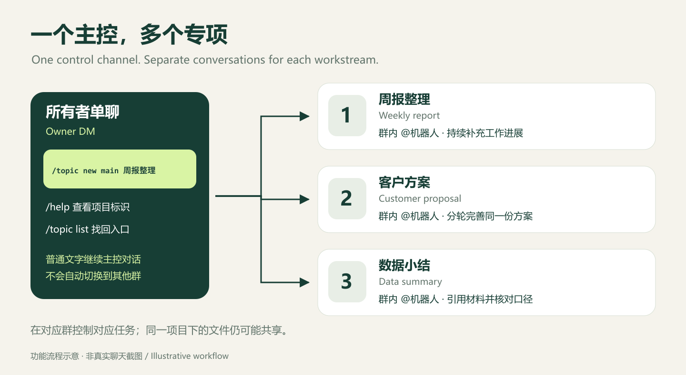
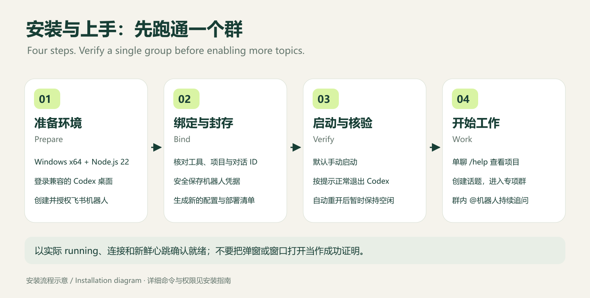

# QIU Bridge v1.0

**把飞书变成电脑上 Codex 的工作入口：手机安排任务，电脑执行，回到桌面继续审阅。**



[下载 v1.0.0](https://github.com/yfanqiu-dot/lark-chatgpt-bridge/releases/tag/v1.0.0) · [安装指南](README.desktop.md) · [完整使用手册](docs/user-guide.zh.md) · [办公示例](docs/office-workflows.zh.md) · [English](README.md)

QIU Bridge 面向已在 Windows 电脑上使用 Codex 的个人用户。它把飞书单聊、专项群与真实 Codex 项目对话连接起来，让你离开电脑后仍可安排工作、补充要求、处理支持的审批，并取回结果。工作由自己的电脑处理，电脑需要保持开机、联网和用户登录。

## 它能解决什么问题

| 你遇到的情况 | 用 QIU Bridge 怎样处理 |
|---|---|
| 人在外面，材料在电脑上 | 在飞书说明项目中的材料路径和目标，由电脑上的 Codex 读取和处理 |
| 周报、客户方案、数据工作混在一起 | 一项工作建立一个专项群和独立对话，后续在原群持续跟进 |
| 每次换入口都要重讲背景 | 接续同一条真实 Codex 项目对话，回到电脑继续审阅 |
| 不知道任务在执行、排队还是等审批 | 用 `/status` 查状态，按支持的审批通知决定下一步 |
| 收不到结果时担心重复执行 | 用 `/result` 取回已保存结果，用 `/reconcile` 核对原请求 |
| 测试群已解散，旧入口仍混在列表中 | 维护者核实并登记退役后，隐藏话题列表和本地阅读索引中的旧入口 |

Bridge 负责消息和对话接续。飞书云文档、日历、任务、多维表格、GitHub 等业务操作，仍需在 Codex 中配置对应工具和授权；安装 Bridge 不会自动获得这些能力。

## 一个主控，多个专项



- **单聊主控（可选）：** 与自己的机器人直接发文字，无需 @；安排主控工作，创建或找回话题。
- **入口群：** 保留群内入口，@机器人安排工作或管理话题。
- **专项群：** 在对应群 @机器人继续同一事项，任务控制和结果归属于该群。
- **电脑上的 Codex：** 项目、对话和产物留在本机，回到桌面继续检查与交付。

单聊不是跨群任务控制台。要停止或查询哪项工作，就到对应群操作。同一项目下的对话可以访问同一批项目文件；对话分开不等于文件隔离。

## 安装：先验证一个群，再扩展



需要 **Windows x64、Node.js 22 LTS、已登录且兼容的 Codex 桌面、自己的飞书机器人**。首次配置需要一定命令行经验。

1. 下载 [Windows ZIP 和 SHA256SUMS.txt](https://github.com/yfanqiu-dot/lark-chatgpt-bridge/releases/tag/v1.0.0)，核对哈希后解压到固定目录。
2. 按[安装指南](README.desktop.md)保存机器人凭据，核对桌面工具基线、项目与已有对话 ID。
3. 用包内工具生成新配置、封存部署和手动服务入口，先验证单群收发。
4. 需要时启用[单聊主控与完整模式](docs/desktop-p4-deployment.md)，使用自己的项目标识创建话题。

运行包包含构建产物、无窗口启动器和生产依赖，不包含 Node.js、Codex、机器人或个人配置。桌面版通过 GitHub Releases 分发，npm 上的原 `lark-channel-bridge` 不是本桌面版安装入口。

**默认手动启动。** 登录自动启动是可选项，需要单独配置。冷启动若要求退出当前 Codex，请先保存工作、正常退出整个应用；自动重新打开后暂时保持空闲，让后台完成检查。以实际状态、连接和新鲜心跳判断就绪，无需等待弹窗。正常退出受管 Codex 会同时关闭飞书渠道。

## 使用：从一份周报开始

在已配置的机器人单聊发送 `/help`，查看项目标识。以下 `main` 是示例，请换成自己的标识：

```text
/topic new main 周报整理
```

点击返回的“进入话题群”，在群内 @机器人发送：

```text
根据本项目本周的工作记录，起草周报。
整理完成事项、风险和下周计划，注明来源文件；缺失信息标为待补充。
先返回文字草稿，不向外发送，不修改原始记录。
```

在同一群继续追问，回到单聊用 `/topic list` 找回入口。创建较慢时先查状态，不重复新建同名话题。

| 指令 | 用途 |
|---|---|
| `/help` | 主控入口帮助和已配置项目标识 |
| `/topic list` | 查看话题入口，排除已登记退役的话题 |
| `/topic new <项目> <名称>` | 显式创建专项群和真实 Codex 对话 |
| `/status` | 查看本对话的执行、排队、待核对及审批状态 |
| `/steer 补充要求` | 给当前活动任务追加要求 |
| `/stop` | 请求停止本对话的当前活动任务；队列仍保留 |
| `/result [原消息编号]` | 取回已保存结果，不重新运行 |
| `/reconcile` | 核对原有不确定请求，不重新提交 |

群内命令也需要 @机器人。审批与 `/topic resume` 的准确用法、文件处理及排队技巧见[完整使用手册](docs/user-guide.zh.md)。

## v1.0.0 的修复与优化

- **无窗口 broker：** GUI 子系统启动器创建不分配控制台的 PowerShell，避免额外驻留 Windows Terminal；保留包身份和进程归属验证。
- **原生 TCP 检查：** 使用 Windows 原生 IPv4/IPv6 监听表，解决旧查询耗时导致的 `shared_observation_stale`；原五秒证明窗口和完整性检查保留。
- **旧话题退役：** 已核实并登记退役的话题不再出现在 `/topic list` 和本地阅读索引；原绑定与账本保留，旧创建请求不会自动重建群。
- **完整图文指南：** 功能、场景、安装、命令、恢复和升级说明及配图随 ZIP 一起提供。

[版本说明](docs/releases/v1.0.0.md) · [验证范围](docs/releases/v1.0.0-validation.md)

## 使用范围

支持 **Windows x64、一个配置所有者、已登记群及显式配置单聊的文字交互**。图片附件不会自动成为模型输入，生成的本地文件不会自动上传飞书。多用户托管、全量桌面消息镜像和长期无人值守保证不在支持范围。

退役是有证据的入口隐藏，不是删除全部历史或停用原生绑定。目前没有统一的 `/topic delete`、`/topic rename` 或 `/topic archive` 命令；不要直接删除绑定对话或清空账本来恢复服务。新机器、Codex 升级及新增项目均需重新验证，详见[兼容性与限制](docs/compatibility.md)。

个人配置、凭据、账本和原始运行证据不随公开源码及运行包分发。请求与结果仍经过飞书和所配置的 Codex 服务，请按业务资料的要求选择工具、平台和授权范围。

## 开发与来源

```powershell
git clone https://github.com/yfanqiu-dot/lark-chatgpt-bridge.git
cd lark-chatgpt-bridge
git checkout v1.0.0
npx --yes pnpm@10.33.0 install --frozen-lockfile
npx --yes pnpm@10.33.0 build
```

开发检查：`pnpm test`、`pnpm typecheck`、`pnpm build`。Windows 源码构建使用系统 .NET Framework C# 编译器生成无窗口启动器；下载运行包无需自行编译。

[开发设计](docs/development.md) · [安全说明](SECURITY.md) · [问题反馈](https://github.com/yfanqiu-dot/lark-chatgpt-bridge/issues) · [原独立 CLI 后端](docs/cli-backend.zh.md)

基于 [zarazhangrui/lark-coding-agent-bridge](https://github.com/zarazhangrui/lark-coding-agent-bridge)，采用 [MIT 许可证](LICENSE)。这是独立社区项目，不是 OpenAI 或飞书官方产品。
