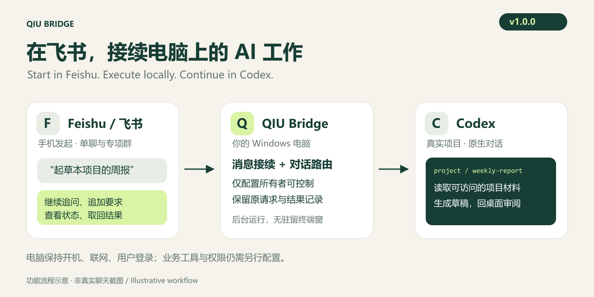

# QIU Bridge v1.0.0

正式发布：2026-11-05。面向 Windows x64、一个配置所有者的 Codex 桌面工作接续。

## 这一版可以做什么

在显式配置的飞书单聊中安排工作、创建和找回专项话题；在对应群 @机器人持续推进任务；回到电脑接续同一条真实 Codex 项目对话。支持状态查询、追加要求、请求停止、支持的审批、已保存结果取回及不确定请求核对。

适用于周报、会议文字整理、客户资料准备和项目内数据小结。业务资料须可由本机工具访问；飞书文档、日历、任务等操作需要另配工具和授权。

## 今天纳入的修复

1. **后台无窗口运行。** 新增 Windows GUI 子系统启动器，以 `CreateNoWindow` 创建原 broker，避免额外驻留的 Windows Terminal。原包身份、租约、进程归属和恢复流程保留，EXE 纳入发布及部署摘要。任务管理器仍能看到必要的后台进程。
2. **原生 TCP 归属检查。** 改用 Windows `GetExtendedTcpTable` 读取 IPv4 和 IPv6 监听表，保留通配地址、真实 PID 与完整进程扫描，解决旧查询耗时导致的 `shared_observation_stale`。不延长五秒证明窗口、不跳过完整性检查。
3. **已解散旧话题的发现入口清理。** 管理员核实并登记退役后，`/topic list` 及本地阅读索引隐藏旧入口；保留原绑定和账本，阻止通过旧创建请求自动重建群。它不是删除历史或停用原生绑定的命令。
4. **图文安装与使用介绍。** 中英文首页重新组织，包含功能、问题场景、安装步骤、命令及边界。三张原创示意图同时提供 PNG 和 SVG，随 ZIP 离线分发。

## 安装与升级

- 新用户：下载本 Release 的 `qiu-bridge-v1.0.0-windows-x64.zip` 和 `SHA256SUMS.txt`，核对哈希，按[安装指南](../../README.desktop.md)配置。包内包含生产依赖及无窗口启动器；另需 Windows x64、Node.js 22 LTS、兼容且已登录的 Codex 和自己的飞书机器人。
- 默认手动启动；登录自动启动仅在用户单独配置后启用。冷启动若要求正常退出 Codex，先保存工作，自动重新打开后暂时保持空闲，以实际状态与新鲜心跳确认就绪。
- 已有部署：保留真实项目、对话、原注册表、账本、审批及退役记录。停止并核验旧消费者后，在新目录中准备程序清单与服务入口；不要覆盖运行中的封存包，也不要运行新装向导重置已有状态。见[升级与恢复](../desktop-p4-deployment.md)。

## 验证范围与已知限制

本版包含本机 Codex `26.1029.7803.0` 的接通与实际无窗口验收：接通独立核验 14 项、窗口核验 9 项通过，56 项完整工具和 9 个原绑定保持一致。此前桌面专项回归 745 项通过；正式发布提交的完整回归和跨平台 CI 结果见合并 PR 与[验证说明](v1.0.0-validation.md)。原始个人进程、群 ID 和账本不公开。

这些证据不替代新机器或新 Codex 版本的现场验收，不承诺长期无人值守。图片附件输入、完整桌面镜像和多用户托管不在本版范围；尚无统一 `/topic delete`、`/topic rename` 或 `/topic archive` 命令。Windows 沙盒初始化仍可能需要在桌面处理。详细行为以[中文手册](../user-guide.zh.md)和[兼容性说明](../compatibility.md)为准。

## English

v1.0.0 is the Windows x64 desktop release for one configured owner. It combines an owner-only Feishu DM, topic groups and real Codex conversations with task status, steering, interruption, supported approvals and saved-result recovery.

This release adds a GUI-subsystem broker launcher without a console window, native IPv4/IPv6 TCP ownership checks, evidence-backed retirement of old discovery links, and illustrated offline guides. Original bindings, ledgers, package identity and admission checks are preserved.

Download the Windows ZIP and checksum, follow [installation](../../README.desktop.md), then verify your own setup. Manual startup is the default; login startup is opt-in. Existing deployments must preserve their state and prepare a new sealed directory. [English guide](../user-guide.en.md) · [Validation](v1.0.0-validation.md).
